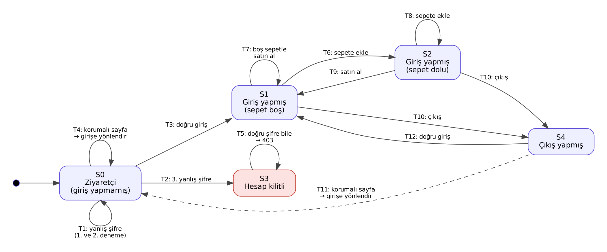

# Test Senaryoları – Mini Oyun Mağazası

## 1. Test Edilecek Fonksiyonlar ve Beklenen Davranışlar

| ID   | Fonksiyon                           | Sayfa                | Sistemden beklenen davranış                                                                                                                                                                                                                        |
|------|-------------------------------------|----------------------|----------------------------------------------------------------------------------------------------------------------------------------------------------------------------------------------------------------------------------------------------|
| F-01 | Kullanıcı kaydı                     | `/kayit`             | Tüm alanlar geçerliyse kullanıcı kaydedilir, giriş sayfasına yönlendirilir ve "Kayıt başarılı! Giriş yapabilirsiniz." mesajı gösterilir.                                                                                                           |
| F-02 | Kayıt formu doğrulama               | `/kayit`             | Boş veya geçersiz veri girilirse kayıt yapılmaz, sayfa 400 kodu ile tekrar gösterilir ve her hata için ayrı bir mesaj çıkar.                                                                                                                       |
| F-03 | Kullanıcı girişi                    | `/giris`             | Doğru bilgilerle giriş yapılır ve oyunlar sayfasına yönlendirilir. Yanlış şifrede 401 kodu ve "Kullanıcı adı veya şifre hatalı." mesajı gösterilir. Boş alanda 400 kodu döner.                                                                     |
| F-04 | Hesap kilitleme                     | `/giris`             | Aynı kullanıcı adıyla 3 kez yanlış şifre girilirse hesap kilitlenir. Sonraki denemelerde (doğru şifre girilse bile) 403 kodu ve "Hesabınız kilitlendi..." mesajı gösterilir.                                                                       |
| F-05 | Sayfa yönlendirme (erişim kontrolü) | `/oyunlar`, `/sepet` | Giriş yapmamış kullanıcı bu sayfalara girmek isterse giriş sayfasına yönlendirilir ve uyarı mesajı gösterilir. Giriş yapmış kullanıcı `/giris` sayfasına girerse oyunlar sayfasına yönlendirilir.                                                  |
| F-06 | Sepete ekleme                       | `/sepete-ekle`       | Adet 1–5 arası bir sayıysa oyun sepete eklenir ve sepet sayfasına yönlendirilir. Boş, sayı olmayan veya aralık dışı adette 400 kodu ve hata mesajı gösterilir. Olmayan bir oyun için 404 kodu döner. Sepette bir oyundan en fazla 5 adet olabilir. |
| F-07 | Satın alma                          | `/satin-al`          | Sepet boşsa "Sepetiniz boş." mesajı gösterilir. Sepet doluysa sepet boşaltılır ve "Satın alma başarılı! Teşekkür ederiz." mesajı gösterilir.                                                                                                       |
| F-08 | Çıkış                               | `/cikis`             | Oturum kapatılır, ana sayfaya yönlendirilir ve "Başarıyla çıkış yaptınız." mesajı gösterilir. Çıkıştan sonra korumalı sayfalara erişilemez.                                                                                                        |

### Giriş alanlarının kuralları

| Alan             | Kural                                                                                  | Hata mesajı                                                                               |
|------------------|----------------------------------------------------------------------------------------|-------------------------------------------------------------------------------------------|
| Kullanıcı adı    | 3–15 karakter, daha önce alınmamış                                                     | "Kullanıcı adı 3-15 karakter olmalıdır." / "Bu kullanıcı adı zaten alınmış."              |
| E-posta          | Geçerli format (ornek@site.com), daha önce kayıtlı değil (büyük/küçük harf fark etmez) | "Geçerli bir e-posta adresi giriniz." / "Bu e-posta zaten kayıtlı."                       |
| Şifre            | 8–20 karakter                                                                          | "Şifre 8-20 karakter olmalıdır."                                                          |
| Şifre tekrar     | Şifre ile aynı                                                                         | "Şifreler eşleşmiyor."                                                                    |
| Yaş              | 13–99 arası tam sayı                                                                   | "Yaş bir sayı olmalıdır." / "Yaş 13 ile 99 arasında olmalıdır."                           |
| Adet             | 1–5 arası tam sayı                                                                     | "Adet boş bırakılamaz." / "Adet bir sayı olmalıdır." / "Adet 1 ile 5 arasında olmalıdır." |
| Boş alan (kayıt) | Hiçbir alan boş olamaz                                                                 | "Tüm alanlar doldurulmalıdır."                                                            |
| Boş alan (giriş) | Kullanıcı adı ve şifre boş olamaz                                                      | "Kullanıcı adı ve şifre boş bırakılamaz."                                                 |

---

## 2. Eşdeğerlik Bölümleme (Equivalence Partitioning)

**Fikir:** Girdileri, sistemin **aynı şekilde davrandığı** gruplara (sınıflara) ayırırız. Her sınıftan **bir temsilci değer** seçmek yeterlidir. Çünkü aynı sınıftaki bütün değerler aynı sonucu vermelidir.

### 2.1 Eşdeğerlik sınıfları

| Alan            | Geçerli sınıflar                            | Geçersiz sınıflar                                                                                                                                         |
|-----------------|---------------------------------------------|-----------------------------------------------------------------------------------------------------------------------------------------------------------|
| Kullanıcı adı   | **GS1:** 3–15 karakter, daha önce alınmamış | **GZ1:** 3 karakterden kısa · **GZ2:** 15 karakterden uzun · **GZ3:** daha önce alınmış · **GZ4:** boş                                                    |
| E-posta         | **GS2:** geçerli format, kayıtlı değil      | **GZ5:** `@` işareti yok · **GZ6:** alan adı yok (`ali@`) · **GZ7:** aynı e-posta zaten kayıtlı · **GZ8:** aynı e-posta farklı büyük/küçük harfle kayıtlı |
| Şifre           | **GS3:** 8–20 karakter                      | **GZ9:** 8 karakterden kısa · **GZ10:** 20 karakterden uzun                                                                                               |
| Şifre tekrar    | **GS4:** şifre ile aynı                     | **GZ11:** şifreden farklı                                                                                                                                 |
| Yaş             | **GS5:** 13–99 arası sayı                   | **GZ12:** 13'ten küçük · **GZ13:** 99'dan büyük · **GZ14:** sayı değil                                                                                    |
| Giriş bilgileri | **GS6:** kayıtlı kullanıcı + doğru şifre    | **GZ15:** yanlış şifre · **GZ16:** kayıtlı olmayan kullanıcı · **GZ17:** boş alan                                                                         |
| Adet            | **GS7:** 1–5 arası sayı                     | **GZ18:** 1'den küçük · **GZ19:** 5'ten büyük · **GZ20:** sayı değil · **GZ21:** boş                                                                      |

### 2.2 Test senaryoları

**Ortak ön koşul (ÖK-1):** Uygulama çalışıyor, `ali` / `ali@test.com` / `oyun12345` kullanıcısı kayıtlı.
**Geçerli varsayılan kayıt verisi:** kullanıcı adı `mehmet`, e-posta `mehmet@test.com`, şifre `oyun12345`, şifre tekrar `oyun12345`, yaş `20`. Her testte **sadece tabloda yazan alan** değiştirilir.

**Kayıt testleri için adımlar:** 1) `/kayit` sayfasını aç → 2) Alanları doldur → 3) "Kayıt Ol" butonuna bas.

| Test ID | Test edilen özellik              | Sınıf   | Ön koşul | Test girdisi                                         | Beklenen sonuç                                         | Gerçekleşen sonuç                                               | Durum               |
|---------|----------------------------------|---------|----------|------------------------------------------------------|--------------------------------------------------------|-----------------------------------------------------------------|---------------------|
| EP-01   | Geçerli kayıt                    | GS1–GS5 | ÖK-1     | Varsayılan geçerli veri                              | Giriş sayfasına yönlendirilir (302), "Kayıt başarılı!" | Beklenen ile aynı                                               | ✅ Başarılı         |
| EP-02   | Kullanıcı adı çok kısa           | GZ1     | ÖK-1     | kullanıcı adı = `ab`                                 | 400, "Kullanıcı adı 3-15 karakter olmalıdır."          | Beklenen ile aynı                                               | ✅ Başarılı         |
| EP-03   | Kullanıcı adı çok uzun           | GZ2     | ÖK-1     | kullanıcı adı = 20 karakter (`aaaaaaaaaaaaaaaaaaaa`) | 400, "Kullanıcı adı 3-15 karakter olmalıdır."          | Beklenen ile aynı                                               | ✅ Başarılı         |
| EP-04   | Kullanıcı adı alınmış            | GZ3     | ÖK-1     | kullanıcı adı = `ali`                                | 400, "Bu kullanıcı adı zaten alınmış."                 | Beklenen ile aynı                                               | ✅ Başarılı         |
| EP-05   | Kullanıcı adı boş                | GZ4     | ÖK-1     | kullanıcı adı = (boş)                                | 400, "Tüm alanlar doldurulmalıdır."                    | Beklenen ile aynı                                               | ✅ Başarılı         |
| EP-06   | E-postada `@` yok                | GZ5     | ÖK-1     | e-posta = `mehmettest.com`                           | 400, "Geçerli bir e-posta adresi giriniz."             | Beklenen ile aynı                                               | ✅ Başarılı         |
| EP-07   | E-postada alan adı yok           | GZ6     | ÖK-1     | e-posta = `mehmet@`                                  | 400, "Geçerli bir e-posta adresi giriniz."             | Beklenen ile aynı                                               | ✅ Başarılı         |
| EP-08   | E-posta zaten kayıtlı            | GZ7     | ÖK-1     | e-posta = `ali@test.com`                             | 400, "Bu e-posta zaten kayıtlı."                       | Beklenen ile aynı                                               | ✅ Başarılı         |
| EP-09   | E-posta farklı harflerle kayıtlı | GZ8     | ÖK-1     | e-posta = `ALI@test.com`                             | 400, "Bu e-posta zaten kayıtlı."                       | 302, kayıt başarılı oldu (aynı e-posta ile ikinci hesap açıldı) | ❌ Başarısız (H-02) |
| EP-10   | Şifre çok kısa                   | GZ9     | ÖK-1     | şifre ve tekrar = `oyun1`                            | 400, "Şifre 8-20 karakter olmalıdır."                  | Beklenen ile aynı                                               | ✅ Başarılı         |
| EP-11   | Şifre çok uzun                   | GZ10    | ÖK-1     | şifre ve tekrar = 25 karakter                        | 400, "Şifre 8-20 karakter olmalıdır."                  | Beklenen ile aynı                                               | ✅ Başarılı         |
| EP-12   | Şifreler eşleşmiyor              | GZ11    | ÖK-1     | şifre tekrar = `baska12345`                          | 400, "Şifreler eşleşmiyor."                            | Beklenen ile aynı                                               | ✅ Başarılı         |
| EP-13   | Yaş çok küçük                    | GZ12    | ÖK-1     | yaş = `10`                                           | 400, "Yaş 13 ile 99 arasında olmalıdır."               | Beklenen ile aynı                                               | ✅ Başarılı         |
| EP-14   | Yaş çok büyük                    | GZ13    | ÖK-1     | yaş = `120`                                          | 400, "Yaş 13 ile 99 arasında olmalıdır."               | Beklenen ile aynı                                               | ✅ Başarılı         |
| EP-15   | Yaş sayı değil                   | GZ14    | ÖK-1     | yaş = `yirmi`                                        | 400, "Yaş bir sayı olmalıdır."                         | Beklenen ile aynı                                               | ✅ Başarılı         |

**Giriş testleri için adımlar:** 1) `/giris` sayfasını aç → 2) Kullanıcı adı ve şifreyi yaz → 3) "Giriş Yap" butonuna bas.

| Test ID | Test edilen özellik       | Sınıf | Ön koşul | Test girdisi            | Beklenen sonuç                                           | Gerçekleşen sonuç | Durum       |
|---------|---------------------------|-------|----------|-------------------------|----------------------------------------------------------|-------------------|-------------|
| EP-16   | Geçerli giriş             | GS6   | ÖK-1     | `ali` / `oyun12345`     | Oyunlar sayfasına yönlendirilir (302), "Giriş başarılı." | Beklenen ile aynı | ✅ Başarılı |
| EP-17   | Yanlış şifre              | GZ15  | ÖK-1     | `ali` / `yanlis123`     | 401, "Kullanıcı adı veya şifre hatalı."                  | Beklenen ile aynı | ✅ Başarılı |
| EP-18   | Kayıtlı olmayan kullanıcı | GZ16  | ÖK-1     | `yokkisi` / `oyun12345` | 401, "Kullanıcı adı veya şifre hatalı."                  | Beklenen ile aynı | ✅ Başarılı |
| EP-19   | Boş alan                  | GZ17  | ÖK-1     | `ali` / (boş)           | 400, "Kullanıcı adı ve şifre boş bırakılamaz."           | Beklenen ile aynı | ✅ Başarılı |

**Sepet testleri için ön koşul (ÖK-2):** ÖK-1 + `ali` ile giriş yapılmış, sepet boş.
**Adımlar:** 1) `/oyunlar` sayfasını aç → 2) Minecraft kartındaki adet alanına değeri yaz → 3) "Sepete Ekle" butonuna bas.

| Test ID | Test edilen özellik | Sınıf | Ön koşul | Test girdisi | Beklenen sonuç                                                | Gerçekleşen sonuç                              | Durum               |
|---------|---------------------|-------|----------|--------------|---------------------------------------------------------------|------------------------------------------------|---------------------|
| EP-20   | Geçerli adet        | GS7   | ÖK-2     | adet = `3`   | Sepet sayfasına yönlendirilir (302), sepette 3 adet Minecraft | Beklenen ile aynı                              | ✅ Başarılı         |
| EP-21   | Adet çok küçük      | GZ18  | ÖK-2     | adet = `-2`  | 400, "Adet bir sayı olmalıdır."                               | 400, "Adet bir sayı olmalıdır." (yanlış mesaj) | ❌ Başarısız (H-05) |
| EP-22   | Adet çok büyük      | GZ19  | ÖK-2     | adet = `10`  | 400, "Adet 1 ile 5 arasında olmalıdır."                       | Beklenen ile aynı                              | ✅ Başarılı         |
| EP-23   | Adet sayı değil     | GZ20  | ÖK-2     | adet = `iki` | 400, "Adet bir sayı olmalıdır."                               | Beklenen ile aynı                              | ✅ Başarılı         |
| EP-24   | Adet boş            | GZ21  | ÖK-2     | adet = (boş) | 400, "Adet boş bırakılamaz."                                  | Beklenen ile aynı                              | ✅ Başarılı         |

> Testler 23.11.2026 tarihinde pytest ile çalıştırıldı (`hatali-surum`).

---

## 3. Sınır Değer Analizi (Boundary Value Analysis)

**Fikir:** Hatalar en çok **sınırlarda** olur (programcı `<` yerine `<=` yazar gibi). Bu yüzden her sınır için 3 değer deneriz: **sınırın hemen altı, sınırın kendisi, sınırın hemen üstü.** Alt ve üst sınır için toplam 6 değer olur.

### 3.1 Sınırlar

| Alan                             | Geçerli aralık | Test edilen değerler    |
|----------------------------------|----------------|-------------------------|
| Kullanıcı adı (uzunluk)          | 3–15 karakter  | 2, 3, 4, 14, 15, 16     |
| Şifre (uzunluk)                  | 8–20 karakter  | 7, 8, 9, 19, 20, 21     |
| Yaş                              | 13–99          | 12, 13, 14, 98, 99, 100 |
| Adet (tek seferde)               | 1–5            | 0, 1, 2, 4, 5, 6        |
| Sepetteki toplam adet (bir oyun) | en fazla 5     | 5, 6                    |

### 3.2 Test senaryoları

**Kayıt testleri:** Ön koşul ÖK-1. Varsayılan geçerli kayıt verisi kullanılır, sadece test edilen alan değiştirilir (şifre testlerinde şifre tekrar alanına da aynı değer yazılır).
**Adımlar:** 1) `/kayit` sayfasını aç → 2) Alanları doldur → 3) "Kayıt Ol" butonuna bas.

| Test ID | Test edilen özellik | Sınır noktası    | Ön koşul | Test girdisi                         | Beklenen sonuç                                | Gerçekleşen sonuç                                        | Durum               |
|---------|---------------------|------------------|----------|--------------------------------------|-----------------------------------------------|----------------------------------------------------------|---------------------|
| BVA-01  | Kullanıcı adı       | Alt sınırın altı | ÖK-1     | 2 karakter: `ab`                     | 400, "Kullanıcı adı 3-15 karakter olmalıdır." | Beklenen ile aynı                                        | ✅ Başarılı         |
| BVA-02  | Kullanıcı adı       | Alt sınır        | ÖK-1     | 3 karakter: `abc`                    | Kayıt başarılı (302)                          | Beklenen ile aynı                                        | ✅ Başarılı         |
| BVA-03  | Kullanıcı adı       | Alt sınırın üstü | ÖK-1     | 4 karakter: `abcd`                   | Kayıt başarılı (302)                          | Beklenen ile aynı                                        | ✅ Başarılı         |
| BVA-04  | Kullanıcı adı       | Üst sınırın altı | ÖK-1     | 14 karakter: `abcdefghijklmn`        | Kayıt başarılı (302)                          | Beklenen ile aynı                                        | ✅ Başarılı         |
| BVA-05  | Kullanıcı adı       | Üst sınır        | ÖK-1     | 15 karakter: `abcdefghijklmno`       | Kayıt başarılı (302)                          | Beklenen ile aynı                                        | ✅ Başarılı         |
| BVA-06  | Kullanıcı adı       | Üst sınırın üstü | ÖK-1     | 16 karakter: `abcdefghijklmnop`      | 400, "Kullanıcı adı 3-15 karakter olmalıdır." | Beklenen ile aynı                                        | ✅ Başarılı         |
| BVA-07  | Şifre               | Alt sınırın altı | ÖK-1     | 7 karakter: `oyun123`                | 400, "Şifre 8-20 karakter olmalıdır."         | Beklenen ile aynı                                        | ✅ Başarılı         |
| BVA-08  | Şifre               | Alt sınır        | ÖK-1     | 8 karakter: `oyun1234`               | Kayıt başarılı (302)                          | 400, "Şifre 8-20 karakter olmalıdır." (kayıt reddedildi) | ❌ Başarısız (H-01) |
| BVA-09  | Şifre               | Alt sınırın üstü | ÖK-1     | 9 karakter: `oyun12345`              | Kayıt başarılı (302)                          | Beklenen ile aynı                                        | ✅ Başarılı         |
| BVA-10  | Şifre               | Üst sınırın altı | ÖK-1     | 19 karakter: `oyun123456789012345`   | Kayıt başarılı (302)                          | Beklenen ile aynı                                        | ✅ Başarılı         |
| BVA-11  | Şifre               | Üst sınır        | ÖK-1     | 20 karakter: `oyun1234567890123456`  | Kayıt başarılı (302)                          | Beklenen ile aynı                                        | ✅ Başarılı         |
| BVA-12  | Şifre               | Üst sınırın üstü | ÖK-1     | 21 karakter: `oyun12345678901234567` | 400, "Şifre 8-20 karakter olmalıdır."         | Beklenen ile aynı                                        | ✅ Başarılı         |
| BVA-13  | Yaş                 | Alt sınırın altı | ÖK-1     | `12`                                 | 400, "Yaş 13 ile 99 arasında olmalıdır."      | Beklenen ile aynı                                        | ✅ Başarılı         |
| BVA-14  | Yaş                 | Alt sınır        | ÖK-1     | `13`                                 | Kayıt başarılı (302)                          | Beklenen ile aynı                                        | ✅ Başarılı         |
| BVA-15  | Yaş                 | Alt sınırın üstü | ÖK-1     | `14`                                 | Kayıt başarılı (302)                          | Beklenen ile aynı                                        | ✅ Başarılı         |
| BVA-16  | Yaş                 | Üst sınırın altı | ÖK-1     | `98`                                 | Kayıt başarılı (302)                          | Beklenen ile aynı                                        | ✅ Başarılı         |
| BVA-17  | Yaş                 | Üst sınır        | ÖK-1     | `99`                                 | Kayıt başarılı (302)                          | Beklenen ile aynı                                        | ✅ Başarılı         |
| BVA-18  | Yaş                 | Üst sınırın üstü | ÖK-1     | `100`                                | 400, "Yaş 13 ile 99 arasında olmalıdır."      | Beklenen ile aynı                                        | ✅ Başarılı         |

**Sepet testleri:** Ön koşul ÖK-2 (ali ile giriş yapılmış, sepet boş).
**Adımlar:** 1) `/oyunlar` sayfasını aç → 2) Minecraft kartındaki adet alanına değeri yaz → 3) "Sepete Ekle" butonuna bas.

| Test ID | Test edilen özellik   | Sınır noktası                | Ön koşul                   | Test girdisi | Beklenen sonuç                                             | Gerçekleşen sonuç                      | Durum               |
|---------|-----------------------|------------------------------|----------------------------|--------------|------------------------------------------------------------|----------------------------------------|---------------------|
| BVA-19  | Adet                  | Alt sınırın altı             | ÖK-2                       | adet = `0`   | 400, "Adet 1 ile 5 arasında olmalıdır."                    | Beklenen ile aynı                      | ✅ Başarılı         |
| BVA-20  | Adet                  | Alt sınır                    | ÖK-2                       | adet = `1`   | Sepete eklenir (302)                                       | Beklenen ile aynı                      | ✅ Başarılı         |
| BVA-21  | Adet                  | Alt sınırın üstü             | ÖK-2                       | adet = `2`   | Sepete eklenir (302)                                       | Beklenen ile aynı                      | ✅ Başarılı         |
| BVA-22  | Adet                  | Üst sınırın altı             | ÖK-2                       | adet = `4`   | Sepete eklenir (302)                                       | Beklenen ile aynı                      | ✅ Başarılı         |
| BVA-23  | Adet                  | Üst sınır                    | ÖK-2                       | adet = `5`   | Sepete eklenir (302)                                       | Beklenen ile aynı                      | ✅ Başarılı         |
| BVA-24  | Adet                  | Üst sınırın üstü             | ÖK-2                       | adet = `6`   | 400, "Adet 1 ile 5 arasında olmalıdır."                    | Beklenen ile aynı                      | ✅ Başarılı         |
| BVA-25  | Sepetteki toplam adet | Üst sınır (4 + 1 = 5)        | ÖK-2 + sepette 4 Minecraft | adet = `1`   | Sepete eklenir (302), sepette 5 adet                       | Beklenen ile aynı                      | ✅ Başarılı         |
| BVA-26  | Sepetteki toplam adet | Üst sınırın üstü (5 + 1 = 6) | ÖK-2 + sepette 5 Minecraft | adet = `1`   | Eklenmez, "Bir oyundan en fazla 5 adet alınabilir." hatası | 302, ürün eklendi, sepette 6 adet oldu | ❌ Başarısız (H-04) |

> Testler 23.11.2026 tarihinde pytest ile çalıştırıldı (`hatali-surum`).

---

## 4. Durum Geçiş Testi (State Transition Testing)

**Fikir:** Sistem her an bir **durumdadır** (örneğin "giriş yapmamış" veya "giriş yapmış"). Bir **olay** olunca (giriş yapmak, çıkış yapmak gibi) başka bir duruma **geçer**. Bu testte, her olaydan sonra sistemin **doğru duruma** geçip geçmediğini kontrol ederiz.

### 4.1 Durumlar

| Durum                          | Açıklama                                                                     |
|--------------------------------|------------------------------------------------------------------------------|
| S0 – Ziyaretçi                 | Giriş yapmamış kullanıcı. Korumalı sayfalara (`/oyunlar`, `/sepet`) giremez. |
| S1 – Giriş yapmış (sepet boş)  | Oturum açık, sepette ürün yok.                                               |
| S2 – Giriş yapmış (sepet dolu) | Oturum açık, sepette en az bir ürün var.                                     |
| S3 – Hesap kilitli             | 3 kez yanlış şifre girilmiş. Doğru şifreyle bile giriş yapılamaz.            |
| S4 – Çıkış yapmış              | Kullanıcı çıkış yapmış. Ziyaretçi (S0) gibi davranmalı.                      |

### 4.2 Durum geçiş diyagramı

Diyagram dosyası: `diyagramlar/durum-gecis-diyagrami.png`

### 4.3 Durum geçiş tablosu

| Geçiş | Mevcut durum                  | Olay                                      | Sonraki durum | Sistemin çıktısı                                        |
|-------|-------------------------------|-------------------------------------------|---------------|---------------------------------------------------------|
| T1    | S0                            | Yanlış şifre (1. veya 2. deneme)          | S0            | 401, "Kullanıcı adı veya şifre hatalı."                 |
| T2    | S0 (2 yanlış deneme yapılmış) | 3. yanlış şifre                           | S3            | 401, hesap kilitlenir                                   |
| T3    | S0                            | Doğru kullanıcı adı ve şifre              | S1            | 302 → `/oyunlar`, "Giriş başarılı."                     |
| T4    | S0                            | `/oyunlar` veya `/sepet` sayfasına gitmek | S0            | 302 → `/giris`, uyarı mesajı                            |
| T5    | S3                            | Doğru şifre ile giriş denemesi            | S3            | 403, "Hesabınız kilitlendi..."                          |
| T6    | S1                            | Sepete geçerli adette oyun eklemek        | S2            | 302 → `/sepet`                                          |
| T7    | S1                            | Boş sepetle "Satın Al"                    | S1            | 302 → `/sepet`, "Sepetiniz boş."                        |
| T8    | S2                            | Sepete oyun eklemek                       | S2            | 302 → `/sepet`                                          |
| T9    | S2                            | "Satın Al"                                | S1            | 302 → `/oyunlar`, "Satın alma başarılı!", sepet boşalır |
| T10   | S1 veya S2                    | "Çıkış Yap"                               | S4            | 302 → `/`, "Başarıyla çıkış yaptınız.", oturum kapanır  |
| T11   | S4                            | `/oyunlar` veya `/sepet` sayfasına gitmek | S0            | 302 → `/giris`, uyarı mesajı                            |
| T12   | S4                            | Doğru kullanıcı adı ve şifre              | S1            | 302 → `/oyunlar`, "Giriş başarılı."                     |

**Geçersiz geçişler** (olmaması gerekenler): S0 → S2 (giriş yapmadan sepete ekleme), S3 → S1 (kilitli hesapla giriş), S4 → S2 (çıkıştan sonra sepete ekleme). Bu geçişler denenirse sistem bunlara izin vermemelidir.

### 4.4 Test senaryoları

**Ön koşul ÖK-1:** Uygulama çalışıyor, `ali` / `oyun12345` kullanıcısı kayıtlı, hiç yanlış giriş denemesi yapılmamış.

| Test ID | Test edilen özellik                            | Geçişler       | Ön koşul | Test girdisi                                                                         | Test adımları                                                                 | Beklenen sonuç                                                              | Gerçekleşen sonuç                                            | Durum               |
|---------|------------------------------------------------|----------------|----------|--------------------------------------------------------------------------------------|-------------------------------------------------------------------------------|-----------------------------------------------------------------------------|--------------------------------------------------------------|---------------------|
| ST-01   | Başarılı giriş                                 | T3             | ÖK-1, S0 | `ali` / `oyun12345`                                                                  | 1) `/giris` aç 2) Bilgileri yaz 3) "Giriş Yap" bas                            | S1'e geçer: 302 → `/oyunlar`, "Giriş başarılı."                             | Beklenen ile aynı                                            | ✅ Başarılı         |
| ST-02   | Tek yanlış giriş                               | T1             | ÖK-1, S0 | `ali` / `yanlis123`                                                                  | 1) `/giris` aç 2) Bilgileri yaz 3) "Giriş Yap" bas                            | S0'da kalır: 401, "Kullanıcı adı veya şifre hatalı."                        | Beklenen ile aynı                                            | ✅ Başarılı         |
| ST-03   | 3 yanlış giriş → hesap kilitlenir              | T1, T1, T2, T5 | ÖK-1, S0 | 3 kez `yanlis123`, sonra `oyun12345`                                                 | 1) 3 kez yanlış şifreyle giriş dene 2) Doğru şifreyle giriş dene              | S3'e geçer: 4. denemede doğru şifreye rağmen 403, "Hesabınız kilitlendi..." | Beklenen ile aynı                                            | ✅ Başarılı         |
| ST-04   | Başarılı giriş yanlış deneme sayacını sıfırlar | T1, T1, T3     | ÖK-1, S0 | 2 kez `yanlis123`, sonra `oyun12345`, sonra (yeni gizli pencerede) 2 kez `yanlis123` | 1) 2 kez yanlış gir 2) Doğru gir 3) Yeni gizli pencere aç 4) 2 kez yanlış gir | Hesap kilitlenmez, son denemede 401 (403 değil)                             | Beklenen ile aynı                                            | ✅ Başarılı         |
| ST-05   | Ziyaretçi oyunlar sayfasına giremez            | T4             | ÖK-1, S0 | —                                                                                    | 1) Giriş yapmadan `/oyunlar` aç                                               | S0'da kalır: 302 → `/giris`, "Bu sayfayı görmek için giriş yapmalısınız."   | Beklenen ile aynı                                            | ✅ Başarılı         |
| ST-06   | Ziyaretçi sepete giremez                       | T4             | ÖK-1, S0 | —                                                                                    | 1) Giriş yapmadan `/sepet` aç                                                 | S0'da kalır: 302 → `/giris`, "Sepeti görmek için giriş yapmalısınız."       | Beklenen ile aynı                                            | ✅ Başarılı         |
| ST-07   | Giriş yapmış kullanıcı giriş sayfasına gidemez | —              | ÖK-1, S1 | —                                                                                    | 1) Giriş yap 2) `/giris` aç                                                   | S1'de kalır: 302 → `/oyunlar`                                               | Beklenen ile aynı                                            | ✅ Başarılı         |
| ST-08   | Sepete ekle ve satın al                        | T6, T9         | ÖK-1, S1 | Minecraft, adet `2`                                                                  | 1) Giriş yap 2) Minecraft'ı 2 adet ekle 3) "Satın Al" bas                     | S1 → S2 → S1: "Satın alma başarılı!", sepet boş                             | Beklenen ile aynı                                            | ✅ Başarılı         |
| ST-09   | Boş sepetle satın alma                         | T7             | ÖK-1, S1 | —                                                                                    | 1) Giriş yap 2) Sepet boşken `/sepet` → "Satın Al" bas                        | S1'de kalır: 302 → `/sepet`, "Sepetiniz boş."                               | Beklenen ile aynı                                            | ✅ Başarılı         |
| ST-10   | Çıkıştan sonra korumalı sayfa                  | T10, T11       | ÖK-1, S1 | —                                                                                    | 1) Giriş yap 2) "Çıkış Yap" bas 3) `/oyunlar` aç                              | S4 → S0: 302 → `/giris`, uyarı mesajı                                       | 200, oyunlar sayfası açıldı (oturum kapanmadı)               | ❌ Başarısız (H-03) |
| ST-11   | Çıkıştan sonra giriş sayfası açılır            | T10            | ÖK-1, S1 | —                                                                                    | 1) Giriş yap 2) "Çıkış Yap" bas 3) `/giris` aç                                | S4: giriş formu görünür (200)                                               | 302 → `/oyunlar`, giriş formu görünmedi                      | ❌ Başarısız (H-03) |
| ST-12   | Çıkıştan sonra tekrar giriş                    | T10, T12       | ÖK-1, S1 | `ali` / `oyun12345`                                                                  | 1) Giriş yap 2) Çıkış yap 3) Tekrar giriş yap                                 | S4 → S1: "Giriş başarılı."                                                  | 302, ama "Giriş başarılı." mesajı yok; oturum hiç kapanmamış | ❌ Başarısız (H-03) |

> Testler 23.11.2026 tarihinde pytest ile çalıştırıldı (`hatali-surum`).

---

## 5. Test Sonuçları Özeti (hatalı sürüm)

| Teknik               | Test sayısı | Başarılı | Başarısız | Bulunan hatalar |
|----------------------|-------------|----------|-----------|-----------------|
| Eşdeğerlik Bölümleme | 24          | 22       | 2         | H-02, H-05      |
| Sınır Değer Analizi  | 26          | 24       | 2         | H-01, H-04      |
| Durum Geçiş Testi    | 12          | 9        | 3         | H-03            |
| **Toplam**           | **62**      | **55**   | **7**     | **5 hata**      |
